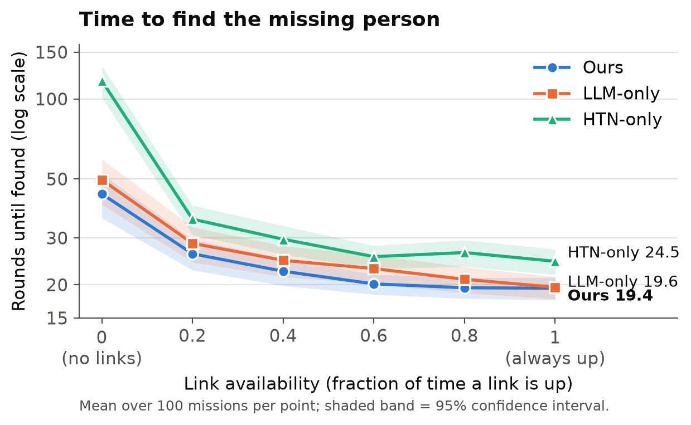
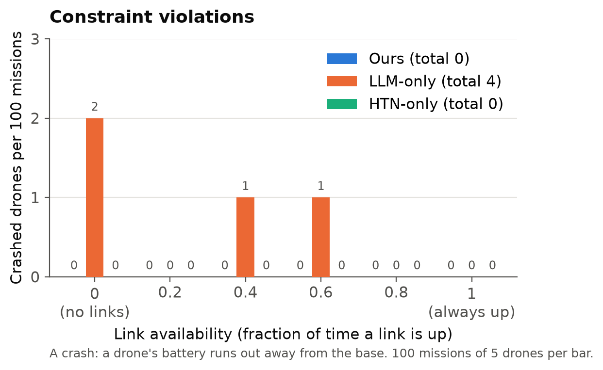
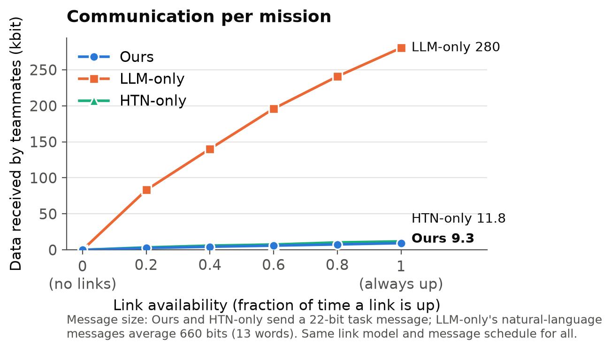

# Experiments (not for merge)

Quick tests from Nov 24–25, shared to show what we tried. Nothing outside `experiments/` is changed.

## node_prototype/

Node-level LLM queries on top of this repository (written against commit 105940f). `run_node.py` wraps `HybridPlanner` and patches a few functions of `agent.py` at run time, so no file of the repository is edited.

- The LLM is asked about specific blanks of the task tree instead of about each silent teammate. `cover_T` asks whether a teammate is already serving target T, and `type_T` asks how many drones T needs.
- A node is asked only when its answer could change the next action. "unknown" is always allowed, and an answer expires after a few rounds.
- With observation on and comms 0, the hybrid planner completes 20/20 missions, while HTN-only completes 2/20.

```
LLM_BASE_URL=http://<host>:<port>/v1 bash experiments/node_prototype/run_node.sh \
    experiments/node_prototype/sweep_conditions.txt 4 5
```

## sar_sim/

A small standalone search-and-rescue simulator (it does not import this repository). The task settings were chosen for a quick test and are not tuned.

- 5 drones search 12 areas for one missing person. The person is placed by one of 5 lost-person profiles, and the drones learn the profile only from a text mission brief.
- Each link is up a fraction q of the time (a two-state Markov chain). While a link is up, the two drones exchange a 22-bit task message: claimed area, status, and searched areas.
- A full charge lasts 60 rounds and recharging takes 8. A drone whose battery runs out away from the base crashes.
- Methods:
  - `htn`: the planner with a uniform prior.
  - `llm`: the LLM picks every area.
  - `node`: the planner, plus an LLM likelihood estimate at launch and cover nodes in flight.

Results over 100 seeds (seeds 101–200). `results/results.csv` has one row per run, and `results/summary.txt` has the tables. Communication volume uses a 22-bit task message for HTN-only and Ours. For LLM-only it uses 660 bits per message, the mean size of the natural-language messages that LLM-only wrote in `results/llm_nl` (method `llm_nl`, 177 runs).





```
cd experiments/sar_sim
python run_sar.py --methods htn --seeds 101-200 --out runs/htn                  # no GPU needed
LLM_BASE_URL=http://<host>:<port>/v1 bash run_sar.sh --methods llm,node --seeds 101-200 --workers 24 --out runs/llm
python aggregate_sar.py runs/htn runs/llm
python plot_results.py results/results.csv results/figs
```
